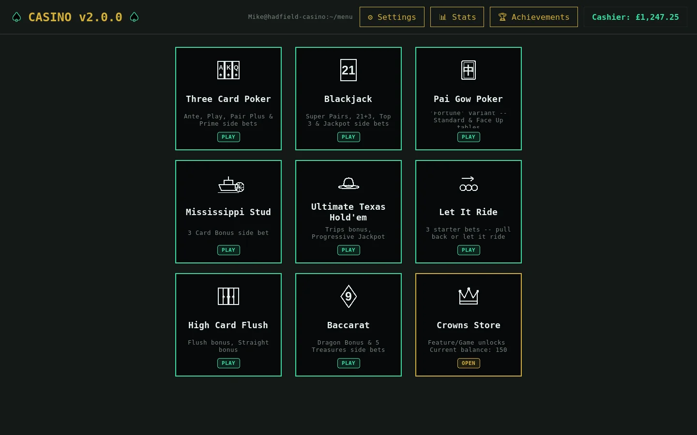
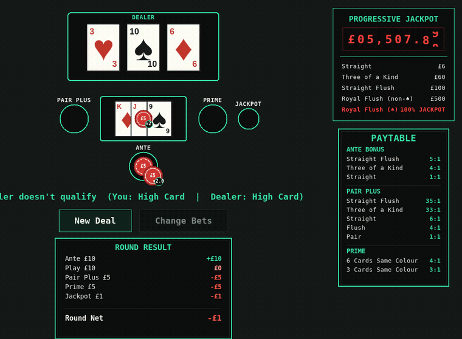
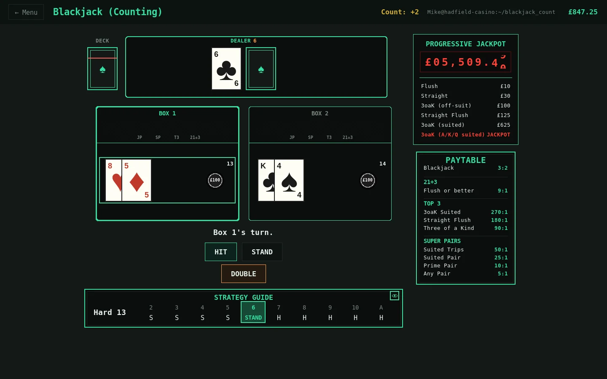
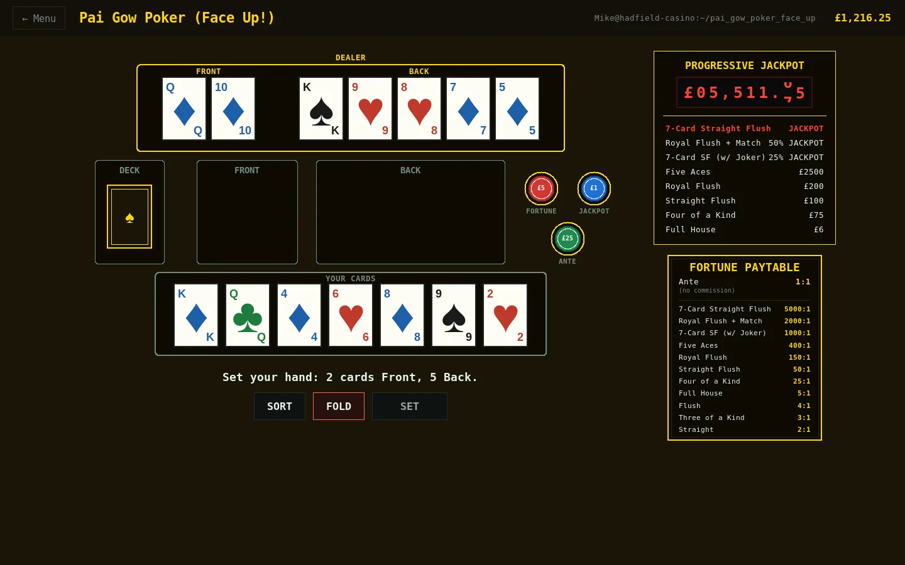

# Hadfield Casino

**Version 2.0.0**

A desktop casino with nine table games, built with nothing but Python's standard library.

Honestly I'm really happy with how this turned out. There are plenty of places it could still go, but at v2.0.0 it's effectively feature complete. The core game logic has since been rolled into [Casino World](https://github.com/mjhadfield/CasinoWorld), a multiplayer casino you can walk around, so this project won't be worked on any further. It's still a good game to dip in and out of though.

## Running it

**Windows:** double-click `Launch Casino (windows).bat`. If Python isn't installed it'll offer to install it just for your user, no admin rights needed.

**Linux:** run `./Launch Casino (linux).sh`. If Python 3 or Tkinter is missing it prints the install command for your distro (apt/pacman/dnf/zypper/apk) rather than installing anything itself.

Or run it directly:

```
python3 main.py
```

Tkinter is the only thing it needs, and some Linux distros don't include it by default:

```
sudo apt install python3-tk        # Debian/Ubuntu
sudo pacman -S tk                  # Arch/CachyOS
```

Your players, balances and stats are saved in a `data` folder, created on first launch.

## What's in it



The table games you'd find in a UK casino, with the proper paytables and side bets. The full rules and payouts for each one are in [docs](docs/):

- [**Three Card Poker**](docs/three-card-poker.md) - Ante/Play, with Pair Plus, Prime and Jackpot side bets
- [**Blackjack**](docs/blackjack.md) - three tables (6:5, Standard and Counting), up to two boxes, with Super Pairs, 21+3, Top 3 and Jackpot side bets
- [**Pai Gow Poker**](docs/pai-gow-poker.md) - with a semi-wild Joker and the House Way, plus a Face Up! table where the dealer goes first
- [**Mississippi Stud**](docs/mississippi-stud.md) - bet or fold on every street
- [**Ultimate Texas Hold'em**](docs/ultimate-texas-holdem.md) - heads-up Hold'em against the dealer
- [**Let It Ride**](docs/let-it-ride.md) - pull your bets back as the hand plays out
- [**High Card Flush**](docs/high-card-flush.md) - the longest flush wins
- [**Baccarat**](docs/baccarat.md) - with Dragon Bonus and 5 Treasures side bets

Every table except Baccarat shares one progressive jackpot, which ticks up in real time while the game's open.

## Attention to detail

I wanted it to feel like sitting at a real table rather than clicking buttons on a form.



Three Card Poker is where this went furthest. Your hand fans out in a slight arc like you're holding it. Press Play and the cards slide up onto the Play box with your chips placed on top of them, or fold onto Pair Plus or Prime and they rest there to show there's still something to collect. The dealer then flips their cards one at a time, half a second apart. Losing chips slide over to the dealer and winnings slide back out, landing just above your stake so you can see what you've won rather than it just replacing the pile.

A few other bits I'm pleased with:

- **The jackpot meter** works like a mechanical odometer. The pennies roll smoothly as it grows, and the pound digits flick over the moment they change, like a real carry
- **Chips** use the real casino colours, and are broken down into proper stacks
- **Blackjack** has a dealer peek, so a dealer Blackjack ends the round before you can double or split into it
- **The counting table** doesn't reshuffle every hand. The shoe shows the cut card, and the running Hi-Lo count in the top bar updates card by card as it's dealt
- **Folding at the Face Up! Pai Gow table** flips your cards face down and throws them off the top of the screen one at a time
- **The 6:5 Blackjack table** is described as what it is: a scam, and in real life you should walk away
- Everything is themed like a terminal (`Mike@hadfield-casino:~/blackjack_count`), right down to the Settings sections (`$ jackpot --config`)
- No image files at all. Every card, chip and icon is drawn in code



## Progression

There's a story mode. A new player starts with only Three Card Poker, and every other table unlocks through achievements. That includes having to put up with the 6:5 Blackjack table before you earn the proper 3:2 one, and playing 500 hands of Blackjack before you get the counting table.

Achievements pay out Crowns, which you spend in the Crowns Store on:
- premium themes that reskin the whole app,
- card styles,
- a four colour deck,
- a Blackjack strategy guide that shows the right play for your hand live at the table (in the screenshot above).

There can be multiple players on one machine, each with their own balance, stats and unlocks. Details in [docs/progression.md](docs/progression.md).



## How it's built

Pure Python and Tkinter, so there's nothing to install beyond Python itself. Each game is split into its rules engine (`logic.py`) and its table screen (`ui.py`), with the cards, chips, money, stats, jackpot and themes shared between them. The variant tables (6:5, Counting, Face Up!) are small subclasses that only change what's different. See [docs/project-layout.md](docs/project-layout.md) for the full layout, and [docs/changelog.md](docs/changelog.md) for the history.
